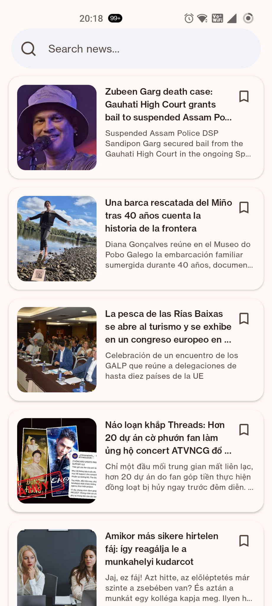

# News App — Android

A modern Android news application built with **Kotlin** and **Jetpack Compose**. Browse the latest news, search for articles, and view results in a clean, card-based interface.

## Screenshots

| Latest news | Search news |
|---|---|
|  |  |

## Features

- **Latest news feed** — displays articles in a scrollable list.
- **Search news** — search articles by keyword.
- **Debounced search** — waits briefly after typing before requesting search results, helping avoid unnecessary API calls.
- **Rounded search field** — pill-shaped search input with a search icon and clear action.
- **Article cards** — thumbnail images, titles, descriptions, rounded corners, and bookmark-style actions.
- **Offline-friendly data layer** — Room can cache articles locally so the UI can observe stored data.
- **Reactive UI** — Kotlin Flow and StateFlow can propagate data and UI-state changes to Compose.
- **Loading and error states** — represent request progress and failures in the UI.

> Features listed above reflect the implementation discussed for this project. Adjust this list if a feature is not yet implemented in your repository.

## Tech stack

- **Kotlin**
- **Jetpack Compose** and Material 3
- **MVVM**
- **Clean Architecture** layering
- **Coroutines**, `Flow`, and `StateFlow`
- **Retrofit** and OkHttp for HTTP requests
- **Room** for local persistence and cached articles
- **Coil** for loading article images
- **Hilt** for dependency injection

## Architecture overview

The app separates UI, business rules, and data access:

```text
Compose UI
    │
    ▼
ViewModel ── exposes UI state with StateFlow
    │
    ▼
Use Case
    │
    ▼
Repository interface
    │
    ▼
Repository implementation
    ├── Retrofit API ── remote news data
    └── Room DAO ────── local article cache
```

### Data flow

- The Compose screen collects state from the ViewModel.
- The ViewModel calls a use case for search or refresh operations.
- The repository retrieves remote data through Retrofit and maps DTOs to domain models.
- Articles can be persisted in Room and observed through a `Flow`.
- State changes trigger Compose recomposition, updating the visible list.

## Search behavior

The search screen uses a controlled text field. The input updates immediately, while a debounce delay can be used before making a request. Blank queries should be handled explicitly so the API is not sent an empty `q` parameter.

Example Retrofit declaration:

```kotlin
@GET("latest")
suspend fun searchNews(
    @Query("q") query: String
): LatestNewsResponseDto
```

For APIs where an empty query should be omitted, make the parameter nullable and pass `null` for blank input:

```kotlin
@GET("latest")
suspend fun searchNews(
    @Query("q") query: String?
): LatestNewsResponseDto
```

## Setup

1. Clone this repository:

   ```bash
   git clone <YOUR_GITHUB_REPOSITORY_URL>
   ```

2. Open the project in Android Studio.
3. Add your news API key using the configuration expected by your project. **Do not commit API keys or secrets to GitHub.**
4. Sync Gradle and run the app on an emulator or Android device.

## Configuration

Before publishing, document the API provider and the exact location where the app expects its API key. Use `local.properties`, a local Gradle property, or another appropriate secret-management approach for development. Keep secrets out of source control.

## Project status

This project demonstrates a Kotlin-first Android news app with a Compose UI, repository-based data access, and a reactive state model. Update this README as features are completed and tested.

## Future improvements

- Persist bookmarked articles in Room.
- Add article detail and share actions.
- Add paging for large result sets.
- Improve empty, loading, offline, and retry states.
- Add unit tests for ViewModels, use cases, and repository mappings.
- Add UI tests for search and article-list behavior.

## Contributing

Issues and pull requests are welcome. For substantial changes, open an issue first to discuss the proposed improvement.

## License

Choose and add a license before publishing this repository publicly.
